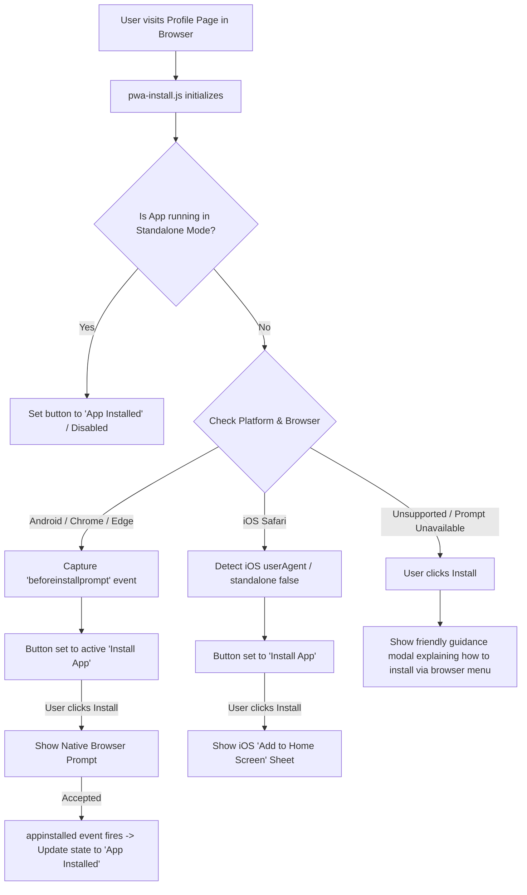

# Progressive Web App (PWA) Installation System Implementation Plan

This document outlines the technical design, architecture, and step-by-step implementation for adding a complete Progressive Web App (PWA) installation system to your PHP website. 

The implementation preserves your existing **PHP + HTML + CSS + JavaScript + MySQL** stack without relying on Flutter, React Native, or external mobile frameworks.

---

## 1. Existing Project Inspection & Architecture Context

Upon inspecting `d:\Wordpress\EarnNow`, only `Prompt.txt` is currently present. 

To give you a turnkey, fully testable, and production-ready solution, we will:
1. Provide a **modular, complete PWA implementation** in this directory, including a functional PHP website setup (Header/Layout, Profile page with "Change Password" and "Install App" button, Mock Auth Session, Offline fallback, Service Worker, Web App Manifest, Install Controller JS, and PWA icon assets).
2. Provide **drop-in instructions and exact code blocks** showing how to embed these into an existing custom PHP website, MVC framework, or WordPress theme.

---

## 2. User Review Required

> [!IMPORTANT]
> **PWA Installation Requirements**:
> - **HTTPS**: PWAs require HTTPS in production. On local environments, `http://localhost` and `http://127.0.0.1` are treated as secure contexts by Chrome, Edge, and Safari.
> - **Service Worker Root Scope**: The Service Worker file (`sw.js`) should be served from the domain root (e.g., `/sw.js` or the base directory of the site) to have scope over the entire application.

> [!NOTE]
> **iOS Safari vs. Android Handling**:
> - Android / Chromium browsers support the native `beforeinstallprompt` event, allowing the "Install App" button to trigger the browser's native install dialog directly.
> - iOS Safari does **not** support `beforeinstallprompt`. Instead, clicking "Install App" on iOS will open a sleek, native-styled bottom sheet / modal with step-by-step visual instructions: **Tap the Share icon <svg> then select 'Add to Home Screen' <svg>**.

---

## 3. Core PWA Components & Workflow

---

## 4. Proposed Changes & Deliverables

### A. Root Assets & Manifest
#### [NEW] `manifest.json`
- Defines app metadata:
  - `name`: "EarnNow - Financial & Earning Platform"
  - `short_name`: "EarnNow"
  - `start_url`: `/` (or relative entry point)
  - `scope`: `/`
  - `display`: `standalone`
  - `orientation`: `portrait-primary`
  - `theme_color`: `#1e293b`
  - `background_color`: `#0f172a`
  - `icons`: Multiple sizes (192x192, 512x512, maskable, apple-touch-icon 180x180)

#### [NEW] `sw.js` (Service Worker)
- **Scope**: Entire site `/`.
- **Caching Strategy**:
  - **Dynamic PHP Pages (`.php` or `mode: 'navigate'`)**: **Network-First** strategy. Always fetches the latest data from the PHP backend. If offline, falls back to a cached `offline.html` page. Never caches dynamic database queries or sensitive responses.
  - **Static Assets (CSS, JS, Fonts, Icons, SVG, Images)**: **Stale-While-Revalidate / Cache-First** with background update to ensure fast load times and offline asset availability.
  - **Authentication / Sensitive Endpoints**: Strict blacklist rule. Never caches requests to `login.php`, `logout.php`, `register.php`, `change-password.php`, `api/`, or any `POST`/`PUT`/`DELETE` requests.
  - **Session & Credentials**: Service worker does not inspect, read, or store session cookies, authorization headers, or database credentials.

#### [NEW] `assets/icons/`
- App icons:
  - `icon-192x192.png`
  - `icon-512x512.png`
  - `icon-maskable-512x512.png`
  - `apple-touch-icon.png` (180x180)
  - `favicon.ico` / `favicon.svg`

---

### B. JavaScript Installation Engine
#### [NEW] `assets/js/pwa-install.js`
- **Standalone Mode Detection**:
  - Checks `window.matchMedia('(display-mode: standalone)').matches` and `window.navigator.standalone === true`.
- **Event Listeners**:
  - Listens to `beforeinstallprompt`: stores the event and enables the button.
  - Listens to `appinstalled`: switches state to "App Installed" and tracks install status.
- **Button State Management**:
  - `Install App` (Ready to trigger prompt or modal)
  - `Installing...` (Native prompt active)
  - `App Installed` (Disabled, checkmark icon)
  - `Installation Unavailable` / Browser instructions fallback
- **iOS Safari Guide Modal**:
  - Custom responsive modal explaining the Share -> "Add to Home Screen" flow with visual icons.
- **Desktop/Other Fallback Modal**:
  - Friendly guide explaining where to find the install icon in Chrome/Edge URL bar or browser menu.

---

### C. PHP Layout & Profile Integration
#### [NEW] `includes/header.php`
- Contains standard HTML5 `<head>` markup with PWA requirements:
  - `<link rel="manifest" href="manifest.json">`
  - `<meta name="theme-color" content="#1e293b">`
  - `<meta name="apple-mobile-web-app-capable" content="yes">`
  - `<meta name="apple-mobile-web-app-status-bar-style" content="black-translucent">`
  - `<meta name="apple-mobile-web-app-title" content="EarnNow">`
  - `<link rel="apple-touch-icon" href="assets/icons/apple-touch-icon.png">`
  - Service worker registration script.

#### [NEW] `profile.php`
- User Profile / Account section:
  - Displays user information and account management options.
  - Existing action: **Change Password** (button / form).
  - New action: **Install App** button integrated right alongside Change Password.
  - Responsive CSS styling ensuring seamless integration.

#### [NEW] `offline.html`
- Clean, brand-consistent offline page displayed when a user navigates without an internet connection.

---

## 5. Security & Authentication Safeguards

| Concern | Solution |
| :--- | :--- |
| **Passwords & Credentials** | Never transmitted through or saved in Service Worker caches. |
| **Session Cookies (PHPSESSID)** | Handled normally by the browser's HTTP stack; Service worker passes credentials transparently (`credentials: 'same-origin'`). |
| **Sensitive Profile Data** | Network-First strategy ensures user profile data is always served fresh from PHP/MySQL; never stored in persistent offline caches. |
| **Cross-User Leakage** | Caching is strictly isolated to immutable static assets. User A's session or account details will never be cached or shown to User B. |
| **HTTPS Enforcement** | PWAs fail gracefully if not on HTTPS; manifests and SW registration check protocol. |

---

## 6. Verification Plan

### Automated & Syntactic Checks
- Validate `manifest.json` syntax and MIME compliance.
- Check Service Worker JavaScript syntax via node / linter.
- Check PHP script syntax (`php -l`).

### Manual Browser & Device Verification
1. **Local PHP Server Test**:
   - Run `php -S localhost:8080` in `d:\Wordpress\EarnNow`.
   - Access `http://localhost:8080/profile.php` in Chrome / Edge.
2. **PWA Audit (Lighthouse)**:
   - Run Lighthouse PWA audit in DevTools to verify installability criteria (manifest, service worker, 192/512 icons, theme-color, offline fallback).
3. **Android / Chrome Simulation**:
   - Test `beforeinstallprompt` event interception.
   - Click "Install App" -> Confirm browser prompt appears -> Accept -> Button transitions to "App Installed".
4. **iOS Safari Simulation**:
   - Change user agent to iOS Safari -> Click "Install App" -> Confirm "Add to Home Screen" instructions modal pops up smoothly.
5. **Standalone Mode Check**:
   - Emulate `display-mode: standalone` in DevTools -> Confirm button immediately displays "App Installed" (disabled).
